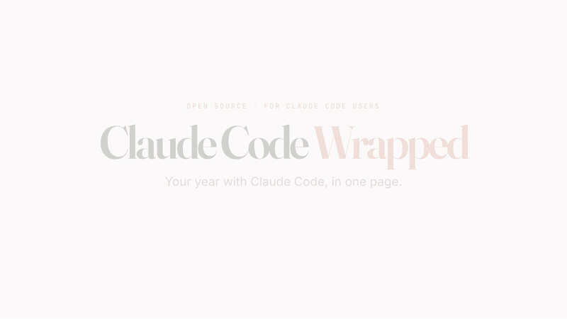
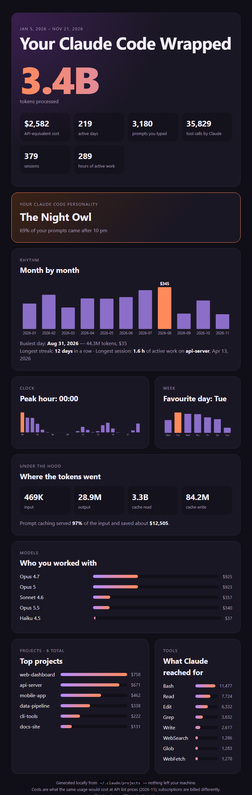

<div align="center">

# Claude Code Wrapped

**Your year with Claude Code, in one page.**
Tokens, API-equivalent cost, models, projects, tools, working hours and your
coding personality, built from the logs already on your machine.



<sub>Report made from <a href="demo/make_demo_logs.py">generated demo logs</a>. ▶ <a href="assets/demo.mp4">Full-quality video</a></sub>

</div>

---

## Quick start

You only need Python 3.9+. Pick one:

```bash
# pipx: runs it without installing anything permanently
pipx run --spec git+https://github.com/andreagiro102-blip/claude-wrapped claude-wrapped

# uv
uvx --from git+https://github.com/andreagiro102-blip/claude-wrapped claude-wrapped

# plain pip
pip install git+https://github.com/andreagiro102-blip/claude-wrapped
claude-wrapped
```

It reads `~/.claude/projects`, writes **`claude-wrapped.html`** in the current folder and opens it
in your browser. The file is self-contained (no network, no external fonts or scripts), so you can
screenshot it, send it, or print it to PDF.

## What's inside

| | |
|---|---|
| **Tokens & cost** | Total tokens split into input, output, cache read and cache write, and what the same usage would cost at API list prices |
| **Your personality** | *The Night Owl*, *The Weekend Warrior*, *The Marathoner*, *The Delegator* or *The Builder*, with the number that earned it |
| **Rhythm** | Month-by-month (or day-by-day for short periods), busiest day, longest streak, longest session |
| **Clock & week** | Your peak hour and favourite weekday |
| **Caching** | How much of the input came from the prompt cache, and roughly how much that saved |
| **Models** | Which Claude models you used and how much each one cost |
| **Projects & tools** | Your top projects, and which tools Claude reached for (Bash, Read, Edit...) |

<details><summary><b>See a full report</b></summary>
<br>
</details>

## Options

| Flag | What it does |
|---|---|
| `--year 2026` | Only one calendar year |
| `--since 2026-10-01` / `--until ...` | Any date range |
| `--hide-projects` | Shows "Project 1, 2..." instead of folder names. **Use it before sharing** |
| `--json` | Prints the raw numbers instead of HTML, for your own charts |
| `--prices prices.json` | Adds or overrides model prices: `{"model-id": [input, output, cache_read]}` in $ per million tokens |
| `-o file.html` | Output path |
| `--no-open` | Don't open the browser |
| `--claude-dir PATH` | Another Claude Code config folder (also respects `CLAUDE_CONFIG_DIR`) |

## Why the numbers differ from other tools

Claude Code writes **one assistant message as several log lines** (one per thinking / text /
tool_use block) and repeats the same `usage` on every line. Tools that sum lines inflate tokens and
cost by **2-3x**. Claude Code Wrapped:

- deduplicates messages by id and keeps the most complete usage
- deduplicates tool calls and prompts that a resumed session copies into a new log file
- counts as **prompts** only what you typed. Tool results, slash commands, task
  notifications and "request interrupted" markers are left out
- measures **active hours** without pauses longer than 15 minutes, so a terminal left open
  overnight does not count
- prices cache writes properly: 1.25x input for the 5-minute TTL, 2x for the 1-hour TTL
- never guesses a price: a model missing from the table is shown as *unpriced*, with its
  tokens still counted

The cost is an **API-equivalent** figure. With a Pro/Max subscription you don't pay it. It shows
what your subscription is worth.

## Only the last 30 days?

By default Claude Code **deletes transcripts older than 30 days**. To keep a full year for next
December, add this to `~/.claude/settings.json`:

```json
{ "cleanupPeriodDays": 365 }
```

The tool reminds you about this when the setting is missing.

## Privacy

- Runs 100% locally. No network calls, no telemetry.
- Message text is never read into the report. Only timestamps, token counts, model names, tool
  names and project folder names are used.
- `--hide-projects` removes folder names too.

## Try it without your own data

```bash
python demo/make_demo_logs.py demo/fake-claude
python -m claude_wrapped --claude-dir demo/fake-claude --year 2026
```

## Development

No dependencies, standard library only.

```bash
git clone https://github.com/andreagiro102-blip/claude-wrapped
cd claude-wrapped
python -m unittest discover -s tests -t .     # tests on synthetic logs
python -m claude_wrapped                       # run from source
```

```
claude_wrapped/
  scan.py       reads the logs and deduplicates messages, tool calls and prompts
  pricing.py    API list prices (update this when new models ship)
  stats.py      aggregates everything into the numbers in the report
  archetype.py  picks your coding personality
  render.py     self-contained HTML with inline SVG charts
```

Contributions are welcome, especially **prices for new models** (`pricing.py`) and **new
personalities** (`archetype.py`).

## License

MIT. Unofficial project, not affiliated with or endorsed by Anthropic.
